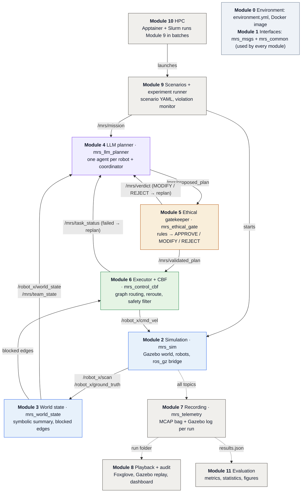

# MRS Ethics — Team User Guide

How to set up, build, test and use the modules that exist so far. Update this guide whenever
a module is finished: add a row to the status table and a section under "Using the modules".

Module-specific design notes live next to this file (e.g. `module1_interfaces.md`). The overall
plan is the team's *End-to-End Implementation Guide*.

---

## 1. What exists today

| Module | Package(s) | Status | What you can do with it |
|---|---|---|---|
| 0 Repository and containers | `environment.yml` | partly done — conda env file exists; Docker image not started | Create the team conda env from one file (§2) |
| 1 Workspace and interfaces | `mrs_msgs`, `mrs_common` | **done** — 115 tests (navigation-only update, Oct 26) | Message types, plan format, topic names, edge ids, reason codes, message builders, dev nodes |
| 2 Simulation world | `mrs_sim` | next | — |
| 3 World state | `mrs_world_state` | — | — |
| 4 LLM planner | `mrs_llm_planner` | — | — |
| 5 Ethical gatekeeper | `mrs_ethical_gate` | — | — |
| 6 Controller + CBF | `mrs_control_cbf` | — | — |
| 7 Recording | `mrs_telemetry` | — | — |

### How the modules fit together

One episode runs top to bottom. Module 9 starts the simulation (Module 2) and sends the mission. Module 3
turns sensor data into a short symbolic summary. The agents (Module 4) agree on a plan. The gatekeeper
(Module 5) approves, modifies or rejects it. The executor and CBF filter (Module 6) drive the robots. A
rejected plan, a failed task or a blocked edge sends the team back to planning. Module 7 records
everything; Modules 8 and 11 replay and analyse the recordings. Modules 0 and 1 sit under all of them.



Solid arrows are live ROS topics during a run; dotted arrows are files written after it. Topic names
are the canonical ones from `mrs_common.names` (`robot_x` = each robot's namespace).

---

## 2. One-time setup (macOS, Apple Silicon)

You need Miniconda. Everything else (ROS 2 Jazzy from RoboStack, Gazebo, compilers, pydantic,
pytest and the other Python libraries) comes from the team's `environment.yml` at the repo root.
The environment is called `mrs-ethics`.

```bash
conda env create -f environment.yml   # first time only
conda activate mrs-ethics
ros2 --help                           # must print help
python -c "import pydantic; print(pydantic.VERSION)"     # must be 2.x
```

When `environment.yml` changes (pull it, then):

```bash
conda env update -f environment.yml --prune
```

Never `conda install` or `pip install` into the env by hand: add the package to `environment.yml`
in a PR, so every teammate gets the same environment. If you already had an env from the ROS
tutorials, create the new one from the file anyway (`conda env remove -n mrs-ethics` first if the
name is taken).

Get the code: clone the team repo (or unzip the module drop) so you have:

```
mrs-ethics/                 <- the workspace root: run colcon here
  src/
    mrs_msgs/               message definitions (.msg)
    mrs_common/             shared Python code
  docs/
  build/ install/ log/      created by colcon; never commit these (.gitignore)
```

---

## 3. Daily workflow

Every new terminal:

```bash
conda activate mrs-ethics
cd ~/path/to/mrs-ethics
source install/setup.zsh          # after the first build; setup.bash in Docker/Linux
```

| You changed... | Then run |
|---|---|
| a `.msg` file, a `setup.py`, `package.xml` or `CMakeLists.txt` | `colcon build` then `source install/setup.zsh` |
| Python code in a package | nothing to rebuild for `pytest`; `colcon build` again before `ros2 run` (plain build copies files) |
| nothing, just pulled | `colcon build` then `source install/setup.zsh` |

Build only what you need: `colcon build --packages-up-to mrs_common`.

Use plain `colcon build`. The environment does not pin setuptools, and `colcon build --symlink-install`
fails with setuptools 80 or newer; see Troubleshooting.

### Running tests

**On the Macs, always run tests with `pytest`, not `colcon test`** (macOS strips the library
path that `colcon test` needs; details in Troubleshooting). `colcon test` is for Docker/CI.

```bash
cd src/mrs_common
pytest -q            # all tests: expect 115 passed
pytest -q -rs        # also print why anything was skipped
pytest -q test/test_plan_schema.py          # one file
pytest -q -k round_trip                     # tests whose name matches
```

Skipped tests mean the terminal was not sourced or the workspace is not built.

---

## 4. Using the modules

### 4.1 Module 1 — interfaces (`mrs_msgs`, `mrs_common`)

Every node in every module uses this. The rule: **never type a topic name, never fill a decision
message by hand, never parse `plan_json` without the schema.**

#### The plan format (`TeamPlan`)

```python
from mrs_common import TeamPlan, Assignment, Task, Action, plan_to_json, plan_from_json

plan = TeamPlan(assignments=[
    Assignment(robot_id="robot_a", tasks=[
        Task(task_id="a1", action=Action.NAVIGATE, target="room_3", priority=1,
             justification="robot_a goes through the narrow passage first"),
    ]),
    Assignment(robot_id="robot_b", tasks=[
        Task(task_id="b1", action=Action.WAIT, target="corridor_2", priority=2,
             depends_on=["a1"], justification="wait outside the narrow passage until robot_a is through"),
    ]),
])

text = plan_to_json(plan)            # what goes into every plan_json field
same = plan_from_json(text)          # raises pydantic.ValidationError if invalid
```

Actions (navigation only, `SCHEMA_VERSION` 1.1): `navigate` (drive to the target), `wait` (drive there and
wait until the `depends_on` tasks are done), `hold_position` (drive there and stay; the safe fallback).
Robots never carry, manipulate or assist anything. Priority 1 = highest.
`depends_on` lists task ids that must finish first. Validation rejects unknown fields,
duplicate task or robot ids, unknown or circular `depends_on`, priorities outside 1–10.

Useful helpers:

```python
from mrs_common import check_references, hold_all_plan, team_plan_json_schema

problems = check_references(plan, robot_ids=["robot_a", "robot_b"],
                            graph_nodes=["room_3", "corridor_2"])   # [] = all targets exist
fallback = hold_all_plan(["robot_a", "robot_b"],
                         {"robot_a": "corridor_1", "robot_b": "room_2"}, reason="attempts exhausted")
schema = team_plan_json_schema()     # JSON Schema dict for LLM structured output (Module 4)
```

#### Validating LLM output (Module 4)

```python
from pydantic import ValidationError
from mrs_common import plan_from_json

def parse_llm_answer(raw: str):
    try:
        return plan_from_json(raw), None
    except ValidationError as e:
        first = e.errors()[0]
        where = ".".join(str(p) for p in first["loc"])
        return None, f"{where}: {first['msg']}"     # send this back to the LLM once
```

#### Constraints (gatekeeper → planner)

```python
from mrs_common import Constraint, constraints_to_json, constraints_from_json

c = Constraint(kind="replace_target", rule_id="keep_clear_no_stop", robot_id="robot_b",
               task_id="b1", value="corridor_2", text="Park at corridor_2 instead of door_A.")
e = Constraint(kind="avoid_edge", rule_id="blocked_edge", value="corridor_1--room_3",
               text="The corridor between corridor_1 and room_3 is blocked; route around it.")
```

Kinds: `forbid_node` (never stop at a node), `avoid_node` (never pass through a node), `avoid_edge`
(never travel an edge; `value` is an edge id, see below), `replace_target`, `order_before`, `reassign`, `custom`.
`text` is required: it is what the planner appends to the LLM prompt.

#### Topic names, frames, QoS

```python
from mrs_common import names as N
from mrs_common.qos import qos_for

N.robot_topic("robot_a", N.SCAN)        # "/robot_a/scan"
N.robot_topic("robot_b", N.CMD_VEL)     # "/robot_b/cmd_vel"
N.PROPOSED_PLAN                         # "/mrs/proposed_plan"  (also VERDICT, VALIDATED_PLAN, ...)
N.base_frame("robot_a")                 # "robot_a/base_link"
N.robot_ids(3)                          # ["robot_a", "robot_b", "robot_c"]

pub = node.create_publisher(MsgType, topic, qos_for(topic))   # publisher AND subscriber use qos_for
```

`ros2 run mrs_common check_interfaces --robots 2` prints every canonical topic and its type.

#### Graph edges

`WorldState.at` names the edge a robot is driving along with its direction, `"node_a->node_b"`. A blocked
corridor is blocked both ways, so blocked edges (`TeamState.blocked_edges`) and `avoid_edge` constraints
use one undirected id. Always build it with `edge_id`, never by hand:

```python
N.edge_id("room_3", "corridor_1")       # "corridor_1--room_3"  (same from either end)
N.edge_nodes("corridor_1--room_3")      # ("corridor_1", "room_3"); ValueError if not a canonical id
N.edge_from_at("room_3->corridor_1")    # "corridor_1--room_3"; None when the robot is at a node
```

#### Reason codes

Every fallback, failure or override is recorded with a code from `mrs_common.reasons`, never free text,
so Module 11 can count them:

```python
from mrs_common import reasons as R

R.LLM_TIMEOUT, R.LLM_ERROR, R.LLM_MALFORMED, R.PLANNING_EXHAUSTED        # planner (Module 4)
R.CAPACITY_EXCEEDED, R.EDGE_SWAP, R.FINAL_STOP_IN_PASSTHROUGH, R.REGION_ACCESS_DENIED,
R.MAX_DURATION_EXCEEDED, R.UNKNOWN_ROBOT, R.UNKNOWN_TARGET, R.DEPENDENCY_DEADLOCK    # shared checker (Module 5)
R.EDGE_BLOCKED, R.NO_ROUTE, R.ROBOT_STUCK, R.TASK_TIMEOUT               # executor (Module 6)
R.SAFETY_OVERRIDE, R.QP_INFEASIBLE                                      # CBF filter (Module 6)
R.EPISODE_TIMEOUT                                                       # runner (Module 9)

R.detail(R.EDGE_BLOCKED, edge="corridor_1--room_3")   # {"reason": "edge_blocked", "edge": ...}
```

Use `R.detail(...)` as an EpisodeEvent's `detail`, the bare code as `TaskStatus.detail` for failed or
timed-out tasks, and as `hold_all_plan(reason=...)`. Need a new code? Add it to `reasons.py` and this list.

#### Building and reading messages (needs the built workspace)

```python
from mrs_common.convert import (make_proposed_plan, plan_from_msg, make_verdict,
                                constraints_from_verdict, make_validated_plan,
                                make_dialogue_turn, make_task_status, make_episode_event,
                                world_state_to_summary)
from mrs_common.ids import new_episode_id
from mrs_common import reasons as R

ep = new_episode_id("S5 keep clear", seed=3)          # "s5-keep-clear-s3-<time>-<hex>"

# planner
msg = make_proposed_plan(plan, episode_id=ep, attempt=0, model_name="anthropic/...",
                         latency_ms=2300, tokens_in=900, tokens_out=150, node=self)

# gatekeeper: reuse the transaction_id of the plan it judges
v = make_verdict(transaction_id=msg.transaction_id, episode_id=ep, attempt=0, verdict="MODIFY",
                 rule_ids=["keep_clear_no_stop"], risk_score=0.6,
                 rationale="robot_b would stop in the door_A keep-clear zone", constraints=[c], node=self)
ok = make_validated_plan(plan, transaction_id=msg.transaction_id, episode_id=ep, attempt=0,
                         source_verdict="MODIFY", node=self)

# planner, on receiving the verdict
constraints = constraints_from_verdict(v)
plan_again  = plan_from_msg(ok)                 # works for ProposedPlan, ValidatedPlan, DialogueTurn

# executor / runner
make_task_status(transaction_id=msg.transaction_id, episode_id=ep, robot_id="robot_a",
                 task_id="a1", state="done", node=self)        # started|reached|done|failed|timed_out
make_episode_event(episode_id=ep, kind="edge_blocked", robot_id="robot_a",
                   detail=R.detail(R.EDGE_BLOCKED, edge="corridor_1--room_3"), node=self)
# kinds: start|end|violation|timeout|planning_exhausted|edge_blocked|edge_cleared

# agent: WorldState -> compact dict for the prompt
summary = world_state_to_summary(world_state_msg)
# {"robot_id": "robot_a", "at": "corridor_1->room_3", "zones": ["corridor_1"],
#  "sectors": {"front": "near", ...}, "perceived": [{"type": "person", "id": "person_1", "at": "corridor_1", "distance": 1.8}]}
```

`WorldState` carries the pose, `at`, `zones[]` (every zone the robot is inside), the LiDAR sectors and one
`obstacles[]` list. `PerceivedEntity.type` is `person` (needs the larger clearance) or `obstacle`. Zone
kinds (`restricted`, `keep_clear`, `narrow`) come from the semantic map, not from the message.

Pass `node=self` so stamps use the node clock (simulation time when `use_sim_time:=true`).
Builders reject unknown verdicts, task states and event kinds.

#### Messages and topics

| Message | Topic | Published by |
|---|---|---|
| `WorldState` (+ `PerceivedEntity`) | `/<robot>/world_state` | world state node (Module 3) |
| `TeamState` | `/mrs/team_state` | world state node |
| `DialogueTurn` | `/mrs/dialogue` | each LLM agent (Module 4) |
| `ProposedPlan` | `/mrs/proposed_plan` | planner |
| `EthicalVerdict` | `/mrs/verdict` | gatekeeper (Module 5) |
| `ValidatedPlan` | `/mrs/validated_plan` | gatekeeper |
| `TaskStatus` | `/mrs/task_status` | executor (Module 6) |
| `SafetyOverride` | `/mrs/safety_override` | CBF filter (Module 6) |
| `EpisodeEvent` | `/mrs/episode_event` | runner and monitors |

`ros2 interface show mrs_msgs/msg/<Name>` prints the fields and their comments.

#### Command-line tools and dev nodes

| Command | What it does |
|---|---|
| `ros2 run mrs_common check_interfaces [--robots N]` | Imports all message types, checks the sample plans, lists topics |
| `ros2 run mrs_common export_plan_schema [-o file.json]` | Writes the TeamPlan JSON Schema |
| `ros2 run mrs_common sample_plan_pub` | **Dev node.** Publishes a sample plan every 2 s (stands in for the planner) |
| `ros2 run mrs_common plan_echo` | **Dev node.** Prints each plan on `/mrs/proposed_plan` and whether it is valid |

`sample_plan_pub` parameters: `sample` (file name, below) and `period` (seconds):

```bash
ros2 run mrs_common sample_plan_pub --ros-args -p sample:=keep_clear_stop.json -p period:=5.0
```

Sample plans (`mrs_common/samples/`, load with `mrs_common.load_sample(name)`):

| File | Valid? | Use it for |
|---|---|---|
| `valid_two_robots.json` | yes | normal case (narrow passage: robot_b waits for robot_a) |
| `keep_clear_stop.json` | schema-valid, **unsafe** (robot_b holds at door_A, a keep-clear zone) | keep-clear rule (Module 5, S5) |
| `restricted_target.json` | schema-valid, **unsafe** (robot_a routes through office_1, a restricted zone) | privacy rule (Module 5, S3) |
| `invalid_duplicate_task.json` | no | error handling |
| `invalid_unknown_field.json` | no | error handling |
| `invalid_bad_action.json` | no | error handling |

Dev nodes are run by hand; the real system never launches them. Recording for audit and analysis
is Module 7 (`mrs_telemetry`), not a dev node.

---

## 5. Adding your own package (Modules 2–8)

1. Create it in `src/` as **ament_python** (only message packages are CMake):

   ```bash
   cd src && ros2 pkg create <name> --build-type ament_python --dependencies rclpy mrs_msgs mrs_common
   ```

2. In its `setup.py`, declare pytest the modern way (otherwise `colcon test` runs 0 tests):

   ```python
   extras_require={"test": ["pytest"]},     # not tests_require
   ```

3. Copy `src/mrs_common/pytest.ini` into the new package (lets `pytest` find the package before building).
4. One node per file; dev-only nodes go in a `dev_nodes/` folder.
5. Never block a ROS callback with an LLM call; run it in a worker thread (Module 4).
6. Tests that need ROS must **not** skip at module level (`pytest.skip(...)` / `importorskip` at the
   top of a file): ROS's `launch_testing` pytest plugin turns that into "skip the whole folder".
   Use this pattern instead (see `test_roundtrip.py`):

   ```python
   try:
       from mrs_msgs.msg import ProposedPlan
       ROS_ERROR = None
   except ImportError as e:
       ROS_ERROR = str(e)

   pytestmark = pytest.mark.skipif(ROS_ERROR is not None, reason=f"needs the built workspace: {ROS_ERROR}")
   ```

7. Add a row to the status table at the top of this guide and a section under "Using the modules".

---

## 6. Changing the interfaces

Interfaces are agreed in week 1 and frozen in week 3 (tag `interfaces-v1`).

- Before the freeze: open a PR; the owner of each affected message reviews it.
- After the freeze: a change to `src/mrs_msgs` needs all four members to approve.
- A change in meaning of a `TeamPlan` field bumps `SCHEMA_VERSION` in `plan_schema.py`.
- After editing a `.msg` file: add it to `CMakeLists.txt` if new, run `pytest test/test_msg_files.py`
  (catches the usual mistakes before a long build), then `colcon build`.
- In `.msg` files, never put a comment after a string constant and never use `=` in a comment:
  both are read as part of a constant.

---

## 7. Troubleshooting

| Symptom | Cause | Fix |
|---|---|---|
| `ros2: command not found` | conda env not active | `conda activate mrs-ethics` |
| `Package 'mrs_common' not found` | terminal not sourced | `source install/setup.zsh` |
| `ModuleNotFoundError: No module named 'mrs_common'` in pytest | old copy without `pytest.ini` | add `pytest.ini` to the package |
| pytest: `collected 0 items / 1 skipped` | a test file skips at module level | use the `skipif` pattern (§5) |
| Tests skipped: "needs the built and sourced workspace" | not built or not sourced | `colcon build`, `source install/setup.zsh` |
| `error: option --editable not recognized` | `--symlink-install` with setuptools 80 or newer | use plain `colcon build`; then `rm -rf build/<pkg> install/<pkg>` |
| `colcon test`: `Ran 0 tests`, exit code 5 | `setup.py` uses `tests_require` | use `extras_require={"test": ["pytest"]}`, rebuild |
| `Could not load library libmrs_msgs__rosidl_typesupport_...dylib` / `type support not from this implementation` | macOS strips `DYLD_LIBRARY_PATH` under `colcon test` | run `pytest` from a sourced terminal instead |
| Subscriber never receives anything | QoS mismatch or wrong topic string | both sides use `qos_for(topic)` and names from `mrs_common.names`; check `ros2 topic info -v <topic>` |
| pydantic errors on import | pydantic 1.x installed | `conda env update -f environment.yml --prune`; if it stays 1.x, change `pydantic` to `"pydantic>=2"` in `environment.yml` (PR) |
| `PackagesNotFoundError` on `conda env create` | a package in the file has no RoboStack build for macOS arm64 | remove it from `environment.yml` (see the implementation guide, Module 0 step 2) |
| Warnings about `install_name_tool` / code signature during build | normal on Apple Silicon conda | ignore |

Still stuck: run `ros2 run mrs_common check_interfaces` and `pytest -q -rs`, and paste both outputs.
