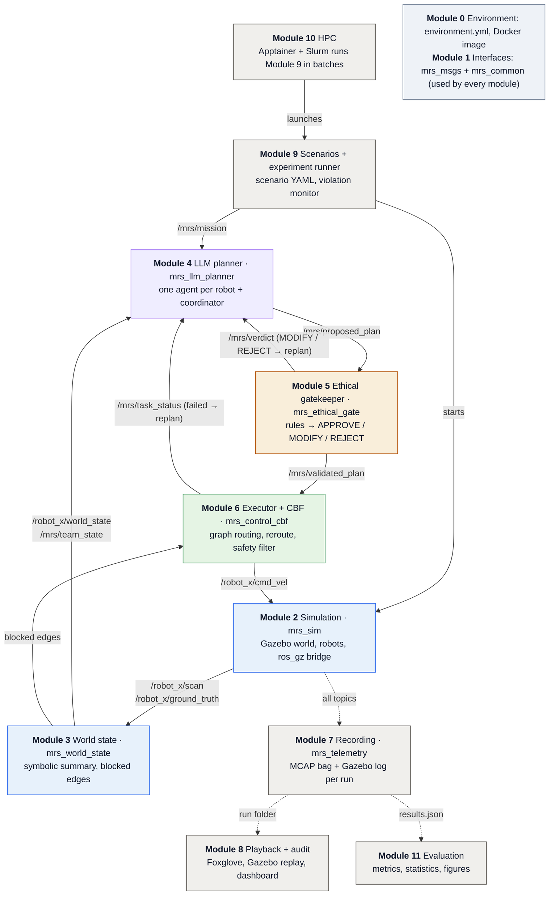

# MRS Ethics — Team User Guide

How to set up, build, test and use the modules that exist so far. Update this guide whenever
a module is finished: add a row to the status table and a section under "Using the modules".

Module-specific design notes live next to this file (e.g. `module1_interfaces.md`). The overall
plan is the team's *End-to-End Implementation Guide*.

---

## 1. What exists today

| Module | Package(s) | Status | What you can do with it |
|---|---|---|---|
| 0 Repository and containers | `environment.yml` | partly done — conda env file exists; Docker image not started | Create the team conda env from one file (§2) |
| 1 Workspace and interfaces | `mrs_msgs`, `mrs_common` | **done** — 122 tests (optional camera topics Oct 28; DialogueTurn agreement protocol Nov 4) | Message types, plan format, topic names, edge ids, reason codes, message builders, dev nodes |
| 2 Simulation world | `mrs_sim` | **first version** — 23 tests; `narrow_aisle` world, 1–4 robots (Oct 28) | Launch a world with N namespaced robots (lidar, optional camera, odom, ground truth), check it with `sim_check` (§4.2) |
| 3 World state | `mrs_world_state` | — | — |
| 4 LLM planner | `mrs_llm_planner` | — | — |
| 5 Ethical gatekeeper | `mrs_ethical_gate`, `fleet_checker` | **first version** — 211 gate + 342 checker tests (Nov 4); APPROVE / REJECT; robots start at the spawn slots, or where `/mrs/team_state` says, with its blocked edges and the people the robots see (tested with a stand-in for Module 3); people (S-2) also from a file; a fake planner (no LLM) to test the replan loop | Check every `ProposedPlan`, publish the `EthicalVerdict` and, on APPROVE, the `ValidatedPlan`; run the REJECT → replan loop with a scripted planner (§4.3) |
| 6 Controller + CBF | `mrs_control_cbf` | — | — |
| 7 Recording | `mrs_telemetry` | — | — |

### How the modules fit together

One episode runs top to bottom. Module 9 starts the simulation (Module 2) and sends the mission. Module 3
turns sensor data into a short symbolic summary. The agents (Module 4) agree on a plan. The gatekeeper
(Module 5) approves, modifies or rejects it. The executor and CBF filter (Module 6) drive the robots. A
rejected plan, a failed task or a blocked edge sends the team back to planning. Module 7 records
everything; Modules 8 and 11 replay and analyse the recordings. Modules 0 and 1 sit under all of them.



Solid arrows are live ROS topics during a run; dotted arrows are files written after it. Topic names
are the canonical ones from `mrs_common.names` (`robot_x` = each robot's namespace).

---

## 2. One-time setup (macOS, Apple Silicon)

You need Miniconda. Everything else (ROS 2 Jazzy from RoboStack, Gazebo, compilers, pydantic,
pytest and the other Python libraries) comes from the team's `environment.yml` at the repo root.
The environment is called `mrs-ethics`.

```bash
conda env create -f environment.yml   # first time only
conda activate mrs-ethics
ros2 --help                           # must print help
python -c "import pydantic; print(pydantic.VERSION)"     # must be 2.x
```

When `environment.yml` changes (pull it, then):

```bash
conda env update -f environment.yml --prune
```

Never `conda install` or `pip install` into the env by hand: add the package to `environment.yml`
in a PR, so every teammate gets the same environment. If you already had an env from the ROS
tutorials, create the new one from the file anyway (`conda env remove -n mrs-ethics` first if the
name is taken).

Get the code: clone the team repo (or unzip the module drop) so you have:

```
mrs-ethics/                 <- the workspace root: run colcon here
  src/
    mrs_msgs/               message definitions (.msg)
    mrs_common/             shared Python code
  docs/
  build/ install/ log/      created by colcon; never commit these (.gitignore)
```

---

## 3. Daily workflow

Every new terminal:

```bash
conda activate mrs-ethics
cd ~/path/to/mrs-ethics
source install/setup.zsh          # after the first build; setup.bash in Docker/Linux
```

| You changed... | Then run |
|---|---|
| a `.msg` file, a `setup.py`, `package.xml` or `CMakeLists.txt` | `colcon build` then `source install/setup.zsh` |
| Python code in a package | nothing to rebuild for `pytest`; `colcon build` again before `ros2 run` (plain build copies files) |
| nothing, just pulled | `colcon build` then `source install/setup.zsh` |

Build only what you need: `colcon build --packages-up-to mrs_common`.

Use plain `colcon build`. The environment does not pin setuptools, and `colcon build --symlink-install`
fails with setuptools 80 or newer; see Troubleshooting.

### Running tests

**On the Macs, always run tests with `pytest`, not `colcon test`** (macOS strips the library
path that `colcon test` needs; details in Troubleshooting). `colcon test` is for Docker/CI.

```bash
cd src/mrs_common
pytest -q            # all tests: expect 122 passed
pytest -q -rs        # also print why anything was skipped
pytest -q test/test_plan_schema.py          # one file
pytest -q -k round_trip                     # tests whose name matches
```

Skipped tests mean the terminal was not sourced or the workspace is not built.

---

## 4. Using the modules

### 4.1 Module 1 — interfaces (`mrs_msgs`, `mrs_common`)

Every node in every module uses this. The rule: **never type a topic name, never fill a decision
message by hand, never parse `plan_json` without the schema.**

#### The plan format (`TeamPlan`)

```python
from mrs_common import TeamPlan, Assignment, Task, Action, plan_to_json, plan_from_json

plan = TeamPlan(assignments=[
    Assignment(robot_id="robot_a", tasks=[
        Task(task_id="a1", action=Action.NAVIGATE, target="room_3", priority=1,
             justification="robot_a goes through the narrow passage first"),
    ]),
    Assignment(robot_id="robot_b", tasks=[
        Task(task_id="b1", action=Action.WAIT, target="corridor_2", priority=2,
             depends_on=["a1"], justification="wait outside the narrow passage until robot_a is through"),
    ]),
])

text = plan_to_json(plan)            # what goes into every plan_json field
same = plan_from_json(text)          # raises pydantic.ValidationError if invalid
```

Actions (navigation only, `SCHEMA_VERSION` 1.1): `navigate` (drive to the target), `wait` (drive there and
wait until the `depends_on` tasks are done), `hold_position` (drive there and stay; the safe fallback).
Robots never carry, manipulate or assist anything. Priority 1 = highest.
`depends_on` lists task ids that must finish first. Validation rejects unknown fields,
duplicate task or robot ids, unknown or circular `depends_on`, priorities outside 1–10.

Useful helpers:

```python
from mrs_common import check_references, hold_all_plan, team_plan_json_schema

problems = check_references(plan, robot_ids=["robot_a", "robot_b"],
                            graph_nodes=["room_3", "corridor_2"])   # [] = all targets exist
fallback = hold_all_plan(["robot_a", "robot_b"],
                         {"robot_a": "corridor_1", "robot_b": "room_2"}, reason="attempts exhausted")
schema = team_plan_json_schema()     # JSON Schema dict for LLM structured output (Module 4)
```

#### Validating LLM output (Module 4)

```python
from pydantic import ValidationError
from mrs_common import plan_from_json

def parse_llm_answer(raw: str):
    try:
        return plan_from_json(raw), None
    except ValidationError as e:
        first = e.errors()[0]
        where = ".".join(str(p) for p in first["loc"])
        return None, f"{where}: {first['msg']}"     # send this back to the LLM once
```

#### Constraints (gatekeeper → planner)

```python
from mrs_common import Constraint, constraints_to_json, constraints_from_json

c = Constraint(kind="replace_target", rule_id="keep_clear_no_stop", robot_id="robot_b",
               task_id="b1", value="corridor_2", text="Park at corridor_2 instead of door_A.")
e = Constraint(kind="avoid_edge", rule_id="blocked_edge", value="corridor_1--room_3",
               text="The corridor between corridor_1 and room_3 is blocked; route around it.")
```

Kinds: `forbid_node` (never stop at a node), `avoid_node` (never pass through a node), `avoid_edge`
(never travel an edge; `value` is an edge id, see below), `replace_target`, `order_before`, `reassign`, `custom`.
`text` is required: it is what the planner appends to the LLM prompt.

#### Topic names, frames, QoS

```python
from mrs_common import names as N
from mrs_common.qos import qos_for

N.robot_topic("robot_a", N.SCAN)        # "/robot_a/scan"
N.robot_topic("robot_b", N.CMD_VEL)     # "/robot_b/cmd_vel"
N.PROPOSED_PLAN                         # "/mrs/proposed_plan"  (also VERDICT, VALIDATED_PLAN, ...)
N.base_frame("robot_a")                 # "robot_a/base_link"
N.robot_ids(3)                          # ["robot_a", "robot_b", "robot_c"]

pub = node.create_publisher(MsgType, topic, qos_for(topic))   # publisher AND subscriber use qos_for
```

`ros2 run mrs_common check_interfaces --robots 2` prints every canonical topic and its type.

#### Graph edges

`WorldState.at` names the edge a robot is driving along with its direction, `"node_a->node_b"`. A blocked
corridor is blocked both ways, so blocked edges (`TeamState.blocked_edges`) and `avoid_edge` constraints
use one undirected id. Always build it with `edge_id`, never by hand:

```python
N.edge_id("room_3", "corridor_1")       # "corridor_1--room_3"  (same from either end)
N.edge_nodes("corridor_1--room_3")      # ("corridor_1", "room_3"); ValueError if not a canonical id
N.edge_from_at("room_3->corridor_1")    # "corridor_1--room_3"; None when the robot is at a node
```

#### Reason codes

Every fallback, failure or override is recorded with a code from `mrs_common.reasons`, never free text,
so Module 11 can count them:

```python
from mrs_common import reasons as R

R.LLM_TIMEOUT, R.LLM_ERROR, R.LLM_MALFORMED, R.NO_AGREEMENT, R.PLANNING_EXHAUSTED   # planner (Module 4)
R.CAPACITY_EXCEEDED, R.EDGE_SWAP, R.HUMAN_CROWDING, R.NODE_OCCUPIED, R.FINAL_STOP_IN_PASSTHROUGH,
R.REGION_ACCESS_DENIED, R.MAX_DURATION_EXCEEDED, R.UNKNOWN_ROBOT, R.UNKNOWN_TARGET, R.DEPENDENCY_DEADLOCK    # shared checker (Module 5)
R.EDGE_BLOCKED, R.NO_ROUTE, R.ROBOT_STUCK, R.TASK_TIMEOUT               # executor (Module 6)
R.SAFETY_OVERRIDE, R.QP_INFEASIBLE                                      # CBF filter (Module 6)
R.EPISODE_TIMEOUT                                                       # runner (Module 9)

R.detail(R.EDGE_BLOCKED, edge="corridor_1--room_3")   # {"reason": "edge_blocked", "edge": ...}
```

`R.NO_AGREEMENT`: a dialogue ended after 3 rounds without every agent accepting one plan; the attempt is
used up and nothing goes to the gatekeeper.

Use `R.detail(...)` as an EpisodeEvent's `detail`, the bare code as `TaskStatus.detail` for failed or
timed-out tasks, and as `hold_all_plan(reason=...)`. Need a new code? Add it to `reasons.py` and this list.

#### Building and reading messages (needs the built workspace)

```python
from mrs_common.convert import (make_proposed_plan, plan_from_msg, make_verdict,
                                constraints_from_verdict, make_validated_plan,
                                make_turn_prompt, make_proposal, make_agreement, make_discussion,
                                make_task_status, make_episode_event,
                                world_state_to_summary)
from mrs_common.ids import new_episode_id
from mrs_common import reasons as R

ep = new_episode_id("S5 keep clear", seed=3)          # "s5-keep-clear-s3-<time>-<hex>"

# planner
msg = make_proposed_plan(plan, episode_id=ep, attempt=0, model_name="anthropic/...",
                         latency_ms=2300, tokens_in=900, tokens_out=150, node=self)

# gatekeeper: reuse the transaction_id of the plan it judges
v = make_verdict(transaction_id=msg.transaction_id, episode_id=ep, attempt=0, verdict="MODIFY",
                 rule_ids=["keep_clear_no_stop"], risk_score=0.6,
                 rationale="robot_b would stop in the door_A keep-clear zone", constraints=[c], node=self)
ok = make_validated_plan(plan, transaction_id=msg.transaction_id, episode_id=ep, attempt=0,
                         source_verdict="MODIFY", node=self)

# planner, on receiving the verdict
constraints = constraints_from_verdict(v)
plan_again  = plan_from_msg(ok)                 # works for ProposedPlan, ValidatedPlan, DialogueTurn (proposals)

# executor / runner
make_task_status(transaction_id=msg.transaction_id, episode_id=ep, robot_id="robot_a",
                 task_id="a1", state="done", node=self)        # started|reached|done|failed|timed_out
make_episode_event(episode_id=ep, kind="edge_blocked", robot_id="robot_a",
                   detail=R.detail(R.EDGE_BLOCKED, edge="corridor_1--room_3"), node=self)
# kinds: start|end|violation|timeout|planning_exhausted|edge_blocked|edge_cleared

# agent: WorldState -> compact dict for the prompt
summary = world_state_to_summary(world_state_msg)
# {"robot_id": "robot_a", "at": "corridor_1->room_3", "zones": ["corridor_1"],
#  "sectors": {"front": "near", ...}, "perceived": [{"type": "person", "id": "person_1", "at": "corridor_1", "distance": 1.8}]}
```

`WorldState` carries the pose, `at`, `zones[]` (every zone the robot is inside), the LiDAR sectors and one
`obstacles[]` list. `PerceivedEntity.type` is `person` (needs the larger clearance) or `obstacle`. Zone
kinds (`restricted`, `keep_clear`, `narrow`) come from the semantic map, not from the message.

Pass `node=self` so stamps use the node clock (simulation time when `use_sim_time:=true`).
Builders reject unknown verdicts, task states and event kinds.

#### Dialogue turns (Module 4)

All negotiation travels on `/mrs/dialogue` as `DialogueTurn`s; every agent and the coordinator receive
every turn. Each turn has a `kind`:

| kind | Sent by | Carries |
|---|---|---|
| `prompt` | the coordinator (`speaker_id` "coordinator") | `next_speaker`: the agent whose turn it is; the prompt that opens an attempt also carries the mission and, after a REJECT, the constraints in `text` |
| `proposal` | an agent, when named | `plan_json`: the plan it proposes; a new proposal replaces the previous one |
| `agreement` | an agent, when named | nothing but optional `text`: it accepts the latest proposal of this attempt unchanged |
| `discussion` | an agent, when named | `text` only |

The dialogue succeeds when every agent has accepted the same proposal (the proposer counts as accepting
its own). The coordinator mints `transaction_id` when a planning cycle starts and keeps it for every attempt.

```python
ids = dict(episode_id=ep, transaction_id=tx, attempt=0)

make_turn_prompt(**ids, round=1, next_speaker="robot_a", text="Mission: ...", node=self)   # coordinator
make_proposal(**ids, round=1, speaker_id="robot_a", plan=plan, text="I go first.", node=self)
make_agreement(**ids, round=1, speaker_id="robot_b", node=self)
make_discussion(**ids, round=2, speaker_id="robot_b", text="corridor_2 looks busy", node=self)
```

The helpers (and the general `make_dialogue_turn`) raise `ValueError` for a turn that breaks the protocol:
an unknown kind, a proposal without a plan, an agreement with a plan, a prompt not from the coordinator or
without `next_speaker`, or an agent turn that names a next speaker. The old `agree` field is gone.

#### Messages and topics

| Message | Topic | Published by |
|---|---|---|
| `WorldState` (+ `PerceivedEntity`) | `/<robot>/world_state` | world state node (Module 3) |
| `TeamState` | `/mrs/team_state` | world state node |
| `DialogueTurn` | `/mrs/dialogue` | each LLM agent and the coordinator (Module 4) |
| `ProposedPlan` | `/mrs/proposed_plan` | coordinator (Module 4) |
| `EthicalVerdict` | `/mrs/verdict` | gatekeeper (Module 5) |
| `ValidatedPlan` | `/mrs/validated_plan` | gatekeeper |
| `TaskStatus` | `/mrs/task_status` | executor (Module 6) |
| `SafetyOverride` | `/mrs/safety_override` | CBF filter (Module 6) |
| `EpisodeEvent` | `/mrs/episode_event` | runner and monitors |

`ros2 interface show mrs_msgs/msg/<Name>` prints the fields and their comments.

#### Command-line tools and dev nodes

| Command | What it does |
|---|---|
| `ros2 run mrs_common check_interfaces [--robots N]` | Imports all message types, checks the sample plans, lists topics |
| `ros2 run mrs_common export_plan_schema [-o file.json]` | Writes the TeamPlan JSON Schema |
| `ros2 run mrs_common sample_plan_pub` | **Dev node.** Publishes a sample plan every 2 s (stands in for the planner) |
| `ros2 run mrs_common plan_echo` | **Dev node.** Prints each plan on `/mrs/proposed_plan` and whether it is valid |

`sample_plan_pub` parameters: `sample` (file name, below) and `period` (seconds):

```bash
ros2 run mrs_common sample_plan_pub --ros-args -p sample:=keep_clear_stop.json -p period:=5.0
```

Sample plans (`mrs_common/samples/`, load with `mrs_common.load_sample(name)`):

| File | Valid? | Use it for |
|---|---|---|
| `valid_two_robots.json` | yes | normal case (narrow passage: robot_b waits for robot_a) |
| `keep_clear_stop.json` | schema-valid, **unsafe** (robot_b holds at door_A, a keep-clear zone) | keep-clear rule (Module 5, S5) |
| `restricted_target.json` | schema-valid, **unsafe** (robot_a routes through office_1, a restricted zone) | privacy rule (Module 5, S3) |
| `invalid_duplicate_task.json` | no | error handling |
| `invalid_unknown_field.json` | no | error handling |
| `invalid_bad_action.json` | no | error handling |

Dev nodes are run by hand; the real system never launches them. Recording for audit and analysis
is Module 7 (`mrs_telemetry`), not a dev node.

### 4.2 Module 2 — simulation (`mrs_sim`)

Starts a Gazebo world with N robots, bridged to the canonical ROS topics. Nothing else from the
stack runs yet, so the robots stand still until something publishes `/<robot>/cmd_vel`.

```bash
ros2 launch mrs_sim sim.launch.py                       # narrow_aisle, 2 robots, camera on, headless
ros2 launch mrs_sim sim.launch.py gui:=true             # also open the Gazebo window
ros2 launch mrs_sim sim.launch.py robots:=4 camera:=false
ros2 launch mrs_sim sim.launch.py world:=aisle_bypass   # any world in src/mrs_sim/worlds/
ros2 launch mrs_sim sim.launch.py world:=/path/to/my_world.sdf   # a world outside the package

# in a second terminal, while it runs:
ros2 run mrs_sim sim_check --drive                      # topics + rates, spawn poses, robots move
ros2 run mrs_sim list_worlds                            # every world, and whether it loads
```

| Launch argument | Default | Meaning |
|---|---|---|
| `world` | `narrow_aisle` | world name in `worlds/`, or a path to a `.sdf` with its `.yaml` next to it |
| `robots` | `2` | robot count; robots are `robot_a`, `robot_b`, ... and take the world's spawn slots in order |
| `camera` | `true` | front camera on every robot; use `false` for batch / HPC runs (smaller recordings, less rendering) |
| `gui` | `false` | also start the Gazebo GUI (a separate `gz sim -g` process, which macOS needs) |
| `verbosity` | `2` | `gz sim -v` level |
| `run_dir` | temp dir | where the generated robot SDFs and `bridge.yaml` are written (printed at start) |

**What each robot publishes** (all names from `mrs_common.names`; `use_sim_time:=true` everywhere):

| Topic | Type | Rate | Frame |
|---|---|---|---|
| `/<robot>/scan` | `LaserScan` (360°, 0.05–10 m) | 10 Hz | `<robot>/lidar` |
| `/<robot>/odom` | `Odometry` (wheel odometry, starts at 0 at spawn) | 30 Hz | `<robot>/odom` → `<robot>/base_link` |
| `/<robot>/ground_truth` | `Odometry` (true pose) | 30 Hz | `map` → `<robot>/base_link` |
| `/<robot>/camera/image_raw`, `.../camera_info` | `Image` 640×480, `CameraInfo` (only with `camera:=true`) | 10 Hz | `<robot>/camera` |
| `/<robot>/cmd_vel` (input) | `Twist`; clamped to 0.5 m/s, 1.5 rad/s | — | — |

TF: `map → <robot>/odom` (static, the spawn pose) `→ <robot>/base_link` (wheel odometry) `→ <robot>/lidar`,
`<robot>/camera` (static). The `map` frame is the Gazebo world frame. Also bridged: `/clock`.

Measured on the Intel i9 MacBook, headless: 2 robots with cameras run at full rate (scan 10 Hz, camera
9.6 Hz, odom 28 Hz); 4 robots without cameras at about 9 Hz scan.

#### Worlds

A world is **two files with the same name** in `src/mrs_sim/worlds/`:

| File | Contains | Used by |
|---|---|---|
| `<name>.sdf` | Gazebo world: floor, walls, lights. `<world name="<name>">` must match the file name | Gazebo |
| `<name>.yaml` | waypoint graph (`nodes`, `edges`), semantic `zones`, robot `spawns` | launch file, Modules 3–5 |

```python
from mrs_sim.world_map import load_world_map
wm, sdf_path = load_world_map("narrow_aisle")
wm.edge_ids()            # ["room_w--room_w_n", ..., "aisle_mid--aisle_w", ...]  (names.edge_id form)
wm.zones_at(6.0, 0.0)    # ["aisle"]                -> WorldState.zones (Module 3)
wm.nearest_node(5.9, 0.1)  # ("aisle_mid", 0.14)    -> WorldState.at (Module 3)
wm.zone("aisle").capacity  # 1                      -> narrow-passage rule (Module 5)
wm.to_prompt_dict()      # compact static map for the LLM system prompt (Module 4)
```

**`narrow_aisle`** (the 295A world): two 4 × 4 m rooms joined by a straight aisle 8 m long and 0.8 m
wide. A robot is 0.40 m wide, so only one fits in the aisle (zone `aisle`, type `narrow`, capacity 1).
`robot_a` starts in the west room, `robot_b` in the east room, both facing the aisle; swapping rooms
forces one to wait. Slots 3 and 4 (`robot_c`, `robot_d`) are the other corners of the rooms.

```
room_w_n (robot_c)                                     room_e_n (robot_b)
     |                                                      |
  room_w ── aisle_w ──── aisle_mid ──── aisle_e ──────── room_e
     |        (the three aisle nodes are in zone "aisle")   |
room_w_s (robot_a)                                     room_e_s (robot_d)
```

#### Adding or switching a world (e.g. `aisle_bypass`)

1. Copy `narrow_aisle.sdf` and `narrow_aisle.yaml` to `aisle_bypass.sdf` / `aisle_bypass.yaml`.
2. In the `.sdf`: rename `<world name="aisle_bypass">` and edit the walls (box collisions in the `walls` model;
   keep them axis-aligned and give each a matching visual).
3. In the `.yaml`: set `world: aisle_bypass`, then the nodes, edges, zones and at least 2 spawn slots.
4. `colcon build --packages-select mrs_sim`, then `cd src/mrs_sim && pytest -q`. The world tests run on
   every world automatically: the yaml validates, the names match, the graph is connected, every node is
   in a zone, and nodes / edges keep clear of the walls (0.30 m / 0.20 m).
5. `ros2 launch mrs_sim sim.launch.py world:=aisle_bypass` and `ros2 run mrs_sim sim_check --world aisle_bypass --drive`.

Nothing else changes: the robots, bridge and launch file are shared by every world. To try a world without
adding it to the package, pass its path: `world:=/path/to/aisle_bypass.sdf`.

#### Robot model

`mrs_sim/templates/mrs_bot.sdf` (+ `camera.sdf`) is filled per robot by `mrs_sim.robot_model.robot_sdf()`:
upstream's `ethics_bot` body (0.45 × 0.30 m, 0.06 m wheels, 0.36 m track) plus two frictionless casters,
each robot in its own colour (a orange, b blue, c green, d purple). Sizes, sensor mounts and speed limits
are constants at the top of `robot_model.py`; the static sensor transforms are generated from the same
numbers, so edit them there, not in the template.

### 4.3 Module 5 — ethical gatekeeper (`mrs_ethical_gate`, `fleet_checker`)

Checks every plan on `/mrs/proposed_plan` against the shared checker's rules and answers each one with
an `EthicalVerdict` on `/mrs/verdict`. On APPROVE it also publishes the plan on `/mrs/validated_plan`
(`source_verdict` APPROVE), the only topic the executor listens to. REJECT carries a rationale and
structured constraints (`constraints_from_verdict`) for the planner's next attempt.

Two packages: `fleet_checker` is the checker itself, pure Python with no ROS imports;
`mrs_ethical_gate` is the node around it. The rules, the verdict mapping and the gate's behaviour are
documented in `src/fleet_checker/docs/rules_v1.md`.

```bash
ros2 launch mrs_ethical_gate gate.launch.py                          # narrow_aisle, 2 robots, sim time
ros2 launch mrs_ethical_gate gate.launch.py world:=aisle_bypass robots:=3   # same values as sim.launch.py

# without a simulation, on the map the sample plans were written for:
ros2 launch mrs_ethical_gate gate.launch.py use_sim_time:=false \
    map_file:=$PWD/src/fleet_checker/test/fixtures/samples_world.yaml
ros2 topic echo /mrs/verdict                                      # second terminal
ros2 run mrs_common sample_plan_pub                               # third: APPROVE, plus a ValidatedPlan
ros2 run mrs_common sample_plan_pub --ros-args -p sample:=keep_clear_stop.json   # REJECT, forbid_node door_A

# S-2 (human crowding): the same map with a person 1.1 m from where valid_two_robots has robot_b wait
ros2 launch mrs_ethical_gate gate.launch.py use_sim_time:=false \
    map_file:=$PWD/src/fleet_checker/test/fixtures/samples_world.yaml \
    people_file:=$PWD/src/mrs_ethical_gate/test/fixtures/samples_world_people.yaml
ros2 run mrs_common sample_plan_pub                               # now REJECT human_crowding

# robots where /mrs/team_state says, with fake_team_state standing in for Module 3 (below)
ros2 launch mrs_ethical_gate gate.launch.py use_sim_time:=false start_source:=team_state margin:=2.0 \
    map_file:=$PWD/src/fleet_checker/test/fixtures/samples_world.yaml
ros2 run mrs_ethical_gate fake_team_state --ros-args -p snapshot:=b_in_passage \
    -p map_file:=$PWD/src/fleet_checker/test/fixtures/samples_world.yaml    # second terminal
ros2 run mrs_common sample_plan_pub                               # third: REJECT, robot_b is in the passage
```

The sample plans use node names (`corridor_1`, `door_A`, `office_1`, ...) that exist only in the test
map `samples_world.yaml`, not in `narrow_aisle`; on `narrow_aisle` every sample is rejected as
`unknown_target`.

| Launch argument | Default | Meaning |
|---|---|---|
| `world` | `narrow_aisle` | world name in `mrs_sim/worlds/`, or a path to a `.sdf` with its `.yaml` next to it |
| `map_file` | empty | a map `.yaml` to use instead of `world` (e.g. a test map with no `.sdf`) |
| `robots` | `2` | robot count; robot *i* starts at the map's spawn slot *i*, as in `sim.launch.py` |
| `people_file` | empty | people for S-2: a YAML list of `{id, x, y}` in the map frame, each inside a zone; empty: `config/people.yaml`, which lists nobody |
| `params_file` | `config/gate.yaml` | the check settings below |
| `use_sim_time` | `true` | stamp messages with simulation time; `false` when no simulation runs |
| `start_source` | empty | `spawns` or `team_state`; empty: the params file's (`spawns`) |
| `margin` | empty | seconds; empty: the params file's (0.5) |

`config/gate.yaml` holds `speed` (nominal driving speed in m/s, used to time each robot's plan; no
default in the code, and the file's value is a placeholder until Module 6's speed is measured),
`robot_length` (for S-4, two robots at one node: a robot is at a node while any part of it is over
it, so driving over a node takes `robot_length / speed`; no default in the code either, and the file's
0.45 m, the chassis of mrs_sim's robot model, is a placeholder), `margin`, `max_duration`, `starvation_threshold`,
`start_source` and `team_state_max_age` (below), and S-2's `crowding_radius` (R) and
`crowding_max_robots` (N): at most N robots within R metres of one person at once. Like `speed`, R and N
have no default in the code, and the file's values (1.5 m, 1) are placeholders, neither measured nor
taken from a standard. `config/policy.yaml` says which
task types may enter which zones; by default no robot may enter a `restricted` zone. Parameters are
read once at start-up: restart the node to change them. The node logs its settings as one JSON line at
start-up and one JSON line per decision (verdict, rule ids, who must replan, fairness ledger,
`latency_ms`, and where the robots were: `positions`).

**Each verdict:**
- `rule_ids` are `mrs_common.reasons` codes.
- `risk_score` is an ordinal level (1.0 a conflict between robots, too many robots near a person, or
  two robots at one node, standing or driving through; 0.67 a zone rule; 0.33 a plan that cannot run or
  cannot be read), not a probability.
- `latency_ms` is the time the check took inside the gate.
- A plan whose `plan_json` cannot be read is rejected with `llm_malformed`.
- With `start_source: team_state`, a plan that arrives while the gate does not know where every robot
  is gets `unknown_robot`, unchecked (below).
- A repeated message (same `transaction_id` and `attempt`) gets the same verdict again.

**Not done yet:**
- `start_source: spawns` (the default) is right only until robots move. `team_state` reads
  `/mrs/team_state`, but Module 3 does not publish it yet: so far it has been tested only with
  `fake_team_state`.
- People come from a file and, with `team_state`, from what the robots see; everyone is taken to stand
  still. S-2 measures straight-line distance, through walls.
- No MODIFY: the gate never repairs a plan itself.
- Assumed, to confirm with Module 4: FALLBACK plans (`hold_all_plan`) go to `/mrs/validated_plan`
  directly, not through the gate. The fake planner (below) does it that way.

Tests: `cd src/fleet_checker && pytest -q` and `cd src/mrs_ethical_gate && pytest -q`. Both run without
ROS, for example in a plain venv; the 23 tests in `test_gate_node.py`, `test_fake_planner_node.py` and
`test_fake_team_state_node.py` also need the built and sourced workspace and skip otherwise.

#### Where the robots are: `start_source: team_state`

With `start_source: team_state` the gate subscribes to `/mrs/team_state` and keeps the latest TeamState.
When a plan arrives it starts each robot of the fleet where that one says: at its node, or, for a robot
between two nodes (`at` = `"a->b"`), at b after first driving the rest of the edge, which counts as a part
of the plan nothing can change (`rules_v1.md`, "Robots on an edge").

It rejects the plan unchecked (`unknown_robot`, one `custom` constraint per problem) when it does not know
where every robot is: no TeamState yet, one of another episode (an empty `episode_id` goes for any), a robot
missing from it, an `at` the map does not have, a robot on an edge posed outside every zone, no stamp, a
position older than `team_state_max_age`, or stamped more than that ahead of the gate's clock (check
`use_sim_time` on both sides), or a robot on a blocked edge (whether it finishes the edge, turns back or
stops is not known). `team_state_max_age` has no default in the code; the file's 1.0 s, two periods of
WorldState's 2 Hz, is a placeholder.

The TeamState's `blocked_edges` are left out of every route, both ways; one that is not an edge of the map
is left out and logged. S-2 checks around the people the robots see (`WorldState.obstacles` of type
person) as well as the people file's; a person in both is where the robots see them. The decision log
lists the blocked edges and every person checked, with where the position came from.

**Use a margin of at least 2 s with `team_state`** until it is measured: a robot counts as at a node up to
0.5 m from it (1 s of driving at 0.5 m/s) and its position can be up to 1 s old, so the start times can be
about 2 s off (`config/gate.yaml`). The decision log gives each check's snapshot age and each robot's,
for measuring that later.

`fake_team_state` is a **development node** standing in for Module 3: it publishes one snapshot file as a
TeamState, every stamp the node clock now, with the file's blocked edges and people (each person in the
WorldState obstacles of the robots that see them, `seen_by`, by default every robot). Parameters: `snapshot` (a name below or a path), `world` /
`map_file` (as for the gate; the snapshot's map must match), `rate` (2.0 Hz), `stop_after` (seconds, 0 =
never; then it exits, so that the gate's last snapshot grows too old), `episode_id` (empty: none).

| Snapshot (`snapshots/`, samples_world) | Where the robots are |
|---|---|
| `at_spawns` | at the spawn slots: plans get the verdicts of `start_source: spawns` |
| `b_in_passage` | robot_b stands at pass_w, inside the one-robot passage `valid_two_robots` has robot_a drive through |
| `b_on_edge` | robot_b is on `corridor_1->pass_e`, 1.2 m before pass_e: its plan first drives into the passage |
| `b_on_blocked_edge` | as `b_on_edge`, but that edge is blocked: the gate checks no plan (`unknown_robot`) |
| `passage_blocked` | at the spawn slots, the passage blocked: the only way between the halls is through the restricted office, so `valid_two_robots` gets P-2 |
| `person_by_corridor_2` | at the spawn slots; robot_b sees the person of `test/fixtures/samples_world_people.yaml`: the same S-2 verdict as that people file gives |

```bash
# the replan loop with positions from fake_team_state: the gate gets start_source team_state and margin 2.0
ros2 launch mrs_ethical_gate replan_loop.launch.py scenario:=s1_passage_no_order team_state:=at_spawns \
    map_file:=$PWD/src/fleet_checker/test/fixtures/samples_world.yaml
```

With `team_state:=...`, `replan_loop.launch.py` starts `fake_team_state` with that snapshot, and the fake
planner 2 s later, so that the gate has a TeamState by then (the topic is volatile). `margin:=...` sets
another margin. The fake planner reads no TeamState: its FALLBACK still holds the robots at their spawn
nodes, and it does not know the blocked edges, so it moves targets by distance on the whole graph and can
change no route. With `team_state:=passage_blocked`, `s1_passage_no_order` is stuck in round 1: P-2's
`avoid_node` constraints are about routes through the office, which a TeamPlan cannot choose.

#### Testing the replan loop: the fake planner

`fake_planner` is a **development node** of this package (`mrs_ethical_gate/dev_nodes/`) for testing the
gate without an LLM. It is not Module 4: it reads no mission or world state and makes no plan of its own.
It sends a scenario's TeamPlan (`model_name: "fake"`), applies each REJECT's constraints to it mechanically,
sends it again, and falls back when it cannot go on.

```bash
# the gate and the fake planner on the same map; everything ends when the fake planner does
ros2 launch mrs_ethical_gate replan_loop.launch.py scenario:=s1_passage_no_order \
    map_file:=$PWD/src/fleet_checker/test/fixtures/samples_world.yaml
# or to a gate that is already running: give it the same map_file (or world) and robots as the gate
ros2 run mrs_ethical_gate fake_planner --ros-args -p scenario:=s1_passage_no_order \
    -p map_file:=$PWD/src/fleet_checker/test/fixtures/samples_world.yaml -p use_sim_time:=false
```

It knows the waypoint graph and the constraints, and reads no zone type, so what it can fix shows how
far the constraints alone guide a replan:

| Constraint | What the fake planner does |
|---|---|
| `order_before` | adds the first task to the later task's `depends_on` |
| `forbid_node` | moves the task's target to the nearest node (along the graph) it has not been refused; if the robot only waits at the node before the task, inserts a `navigate` to such a node first |
| `avoid_node` | moves each task target that is avoided; if no task goes there, the route crosses it, which a TeamPlan cannot change: not applied |
| `custom` | not applied: it is text for an LLM |

A REJECT it can act on gives the next attempt (same `transaction_id`, `attempt` + 1). When it can change
nothing (stuck), or after `max_attempts` plans (exhausted; 5, a placeholder until Module 4's cap is known),
it publishes `hold_all_plan` on `/mrs/validated_plan` itself, as `FALLBACK`, with a `planning_exhausted`
EpisodeEvent: the way Module 4 is assumed to, not through the gate (`rules_v1.md`, "Module 5 gate").

Scenarios (`scenarios/`; give a name or a path), all on samples_world:

| Scenario | What happens |
|---|---|
| `s1_passage_no_order` | REJECT `capacity_exceeded` with an `order_before`; approved in round 2 |
| `s4_both_hold_room_3` | REJECT `node_occupied` with only a `custom` constraint, for robot_b, which got there first and stays: stuck, FALLBACK |
| `p1_keep_clear_stop` | approved in round 4: robot_b's target moves from door_A to office_e (restricted) to corridor_1, then, since robot_a has to drive through corridor_1 and robot_b waiting for it would make them meet at room_3, to corridor_2 |
| `p2_restricted_target` | approved in round 3: robot_a's waypoint moved out of the office, then an `order_before` |
| `s4_park_after_pass` | REJECT `node_occupied`: robot_b would park at corridor_1, which robot_a drives through; robot_b gets an `order_before` to wait until robot_a has gone by, and round 2 is approved with both targets kept |

These rounds are with the gate's default margin of 0.5 s. With `team_state:=at_spawns` (margin 2.0),
`s1_passage_no_order` takes one round more: approved in round 3, after an `order_before` at corridor_1 (S-4).

It logs one JSON line per round and a summary: the outcome; for each kind of constraint and rule, how many
it changed the plan for, noted (nothing to change, the node is kept out of that robot's tasks from then
on) or could not apply, and why; the task targets it changed. `summary_file:=...` also writes the summary
as JSON. Exit code 0 when the loop ran to an outcome, 1 for a parameter or scenario it cannot run, 2 when
no gate answered. Parameters: `scenario`, `world` / `map_file` / `robots` (as for the gate),
`max_attempts`, `gate_wait` and `verdict_timeout` (seconds, 10.0 each), `summary_file`, `episode_id`
(empty: a new one per run, so the gate starts with an empty ledger). `examples/fake_planner_s1_round2.json`
is one recorded run of `s1_passage_no_order`.

#### Benchmarks of the checker

`code/mrs-ethics/benchmarks/` measures, in the plain venv, how long a check takes (2 to 32 robots, split
into compile, detection and the rechecks that verify constraints) and how far the constraints get the fake
planner. One command reruns everything, from the repository root:

```bash
.venv/bin/python code/mrs-ethics/benchmarks/run.py           # full run, into benchmarks/reports/<date>_<machine>/
.venv/bin/python code/mrs-ethics/benchmarks/run.py --quick   # a few scenarios per cell
```

Scenarios come from committed seeds and are checked against `benchmarks/manifest.csv`.
`benchmarks/compare.py` compares two versions of the checker: whether their verdicts are identical,
and how long each takes, cell by cell, in turns. See `benchmarks/README.md`.

---

## 5. Adding your own package (Modules 2–8)

1. Create it in `src/` as **ament_python** (only message packages are CMake):

   ```bash
   cd src && ros2 pkg create <name> --build-type ament_python --dependencies rclpy mrs_msgs mrs_common
   ```

2. In its `setup.py`, declare pytest the modern way (otherwise `colcon test` runs 0 tests):

   ```python
   extras_require={"test": ["pytest"]},     # not tests_require
   ```

3. Copy `src/mrs_common/pytest.ini` into the new package (lets `pytest` find the package before building).
4. One node per file; dev-only nodes go in a `dev_nodes/` folder.
5. Never block a ROS callback with an LLM call; run it in a worker thread (Module 4).
6. Tests that need ROS must **not** skip at module level (`pytest.skip(...)` / `importorskip` at the
   top of a file): ROS's `launch_testing` pytest plugin turns that into "skip the whole folder".
   Use this pattern instead (see `test_roundtrip.py`):

   ```python
   try:
       from mrs_msgs.msg import ProposedPlan
       ROS_ERROR = None
   except ImportError as e:
       ROS_ERROR = str(e)

   pytestmark = pytest.mark.skipif(ROS_ERROR is not None, reason=f"needs the built workspace: {ROS_ERROR}")
   ```

7. Add a row to the status table at the top of this guide and a section under "Using the modules".

---

## 6. Changing the interfaces

Interfaces are agreed in week 1 and frozen in week 3 (tag `interfaces-v1`).

- Before the freeze: open a PR; the owner of each affected message reviews it.
- After the freeze: a change to `src/mrs_msgs` needs all four members to approve.
- A change in meaning of a `TeamPlan` field bumps `SCHEMA_VERSION` in `plan_schema.py`.
- After editing a `.msg` file: add it to `CMakeLists.txt` if new, run `pytest test/test_msg_files.py`
  (catches the usual mistakes before a long build), then `colcon build`.
- In `.msg` files, never put a comment after a string constant and never use `=` in a comment:
  both are read as part of a constant.

Change log:

- **Nov 4 — `DialogueTurn`** (PR #14). `agree` is replaced by `kind` (`prompt` / `proposal` / `agreement` /
  `discussion`) and `next_speaker` is added, so an agent can propose without agreeing and the coordinator
  can name the next speaker (Module 4 agreement protocol). `make_dialogue_turn` changed accordingly and
  gained the helpers `make_turn_prompt`, `make_proposal`, `make_agreement`, `make_discussion`;
  `R.NO_AGREEMENT` was added. No node used the message yet. After pulling: `colcon build`, then `pytest`.

---

## 7. Troubleshooting

| Symptom | Cause | Fix |
|---|---|---|
| `ros2: command not found` | conda env not active | `conda activate mrs-ethics` |
| `Package 'mrs_common' not found` | terminal not sourced | `source install/setup.zsh` |
| `ModuleNotFoundError: No module named 'mrs_common'` in pytest | old copy without `pytest.ini` | add `pytest.ini` to the package |
| pytest: `collected 0 items / 1 skipped` | a test file skips at module level | use the `skipif` pattern (§5) |
| Tests skipped: "needs the built and sourced workspace" | not built or not sourced | `colcon build`, `source install/setup.zsh` |
| `error: option --editable not recognized` | `--symlink-install` with setuptools 80 or newer | use plain `colcon build`; then `rm -rf build/<pkg> install/<pkg>` |
| `colcon test`: `Ran 0 tests`, exit code 5 | `setup.py` uses `tests_require` | use `extras_require={"test": ["pytest"]}`, rebuild |
| `Could not load library libmrs_msgs__rosidl_typesupport_...dylib` / `type support not from this implementation` | macOS strips `DYLD_LIBRARY_PATH` under `colcon test` | run `pytest` from a sourced terminal instead |
| Subscriber never receives anything | QoS mismatch or wrong topic string | both sides use `qos_for(topic)` and names from `mrs_common.names`; check `ros2 topic info -v <topic>` |
| pydantic errors on import | pydantic 1.x installed | `conda env update -f environment.yml --prune`; if it stays 1.x, change `pydantic` to `"pydantic>=2"` in `environment.yml` (PR) |
| `PackagesNotFoundError` on `conda env create` | a package in the file has no RoboStack build for macOS arm64 | remove it from `environment.yml` (see the implementation guide, Module 0 step 2) |
| Warnings about `install_name_tool` / code signature during build | normal on Apple Silicon conda | ignore |
| `malformed launch argument` | launch arguments need `:=` | `world:=narrow_aisle`, not `world=narrow_aisle` |
| `sim_check` fails right after launch | robots still spawning (takes about 10 s) | wait for both `Entity creation successful` lines, run it again |
| Gazebo or bridge processes left over after Ctrl-C | a launch was killed hard | `pkill -f "gz sim"; pkill -f parameter_bridge; pkill -f static_transform_publisher` |
| `gz sdf -k` warns `gz_frame_id ... not defined in SDF` | Gazebo-specific tag, read by the sensors | ignore |
| A new world fails `test_nodes_and_edges_clear_of_walls` | a node or edge is too close to a wall | move the node, or widen the gap in the `.sdf` |
| `AttributeError: ... DialogueTurn ... 'kind'` or `unexpected keyword 'agree'` | built against the old `DialogueTurn` | `colcon build --packages-up-to mrs_common`, then `source install/setup.zsh` |

Still stuck: run `ros2 run mrs_common check_interfaces` and `pytest -q -rs`, and paste both outputs.
